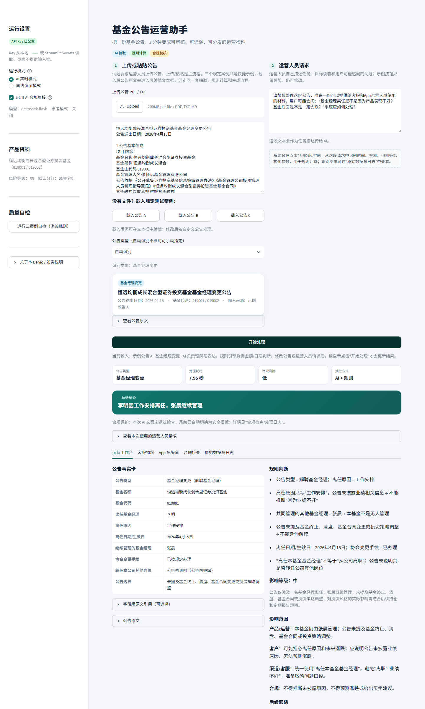
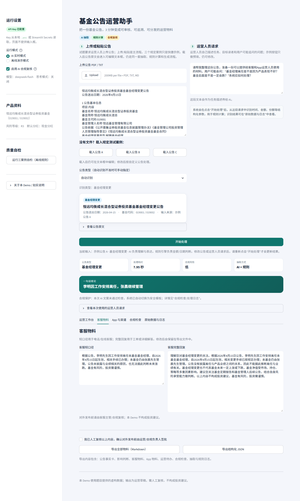
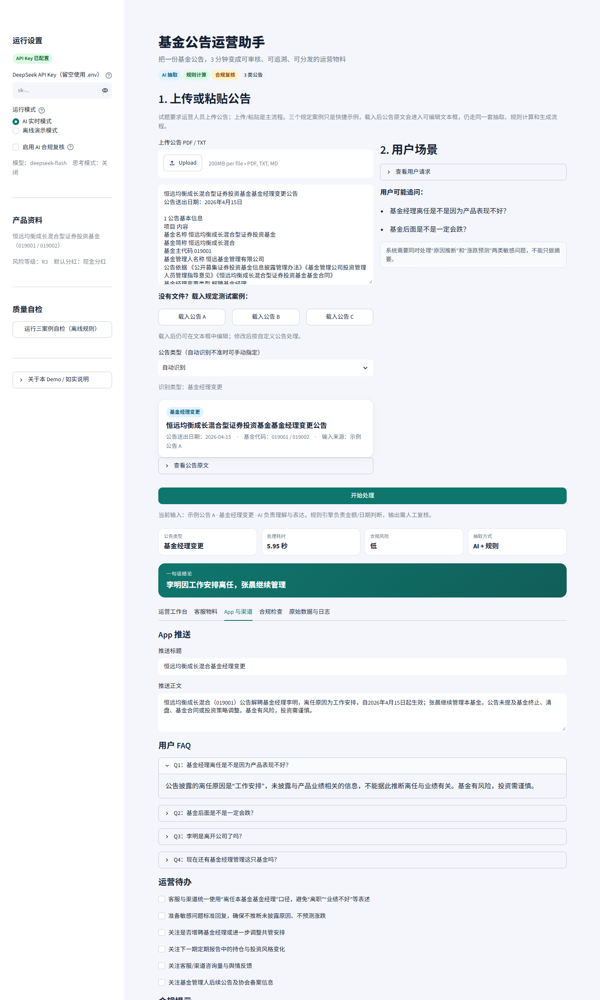
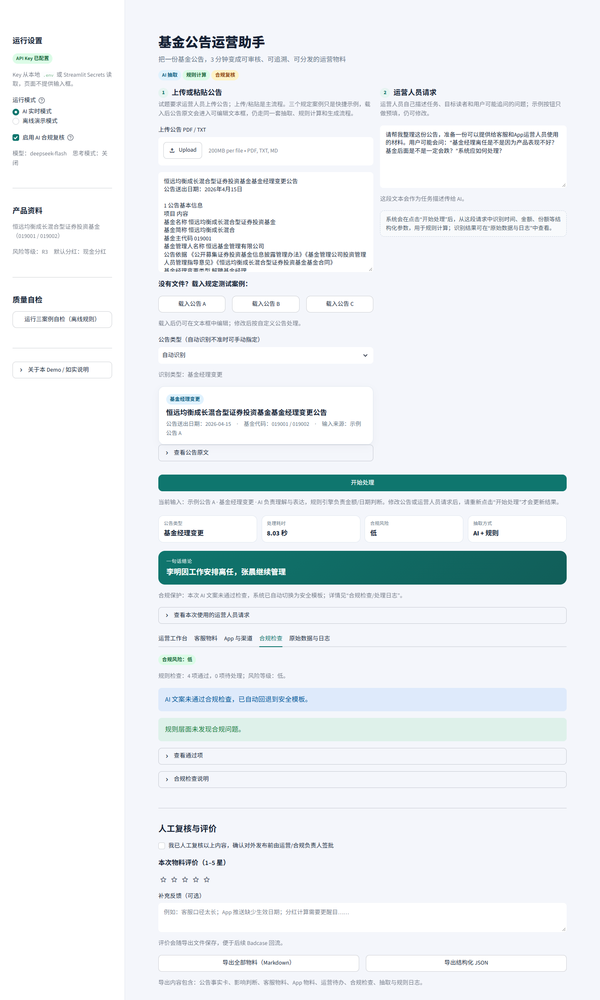
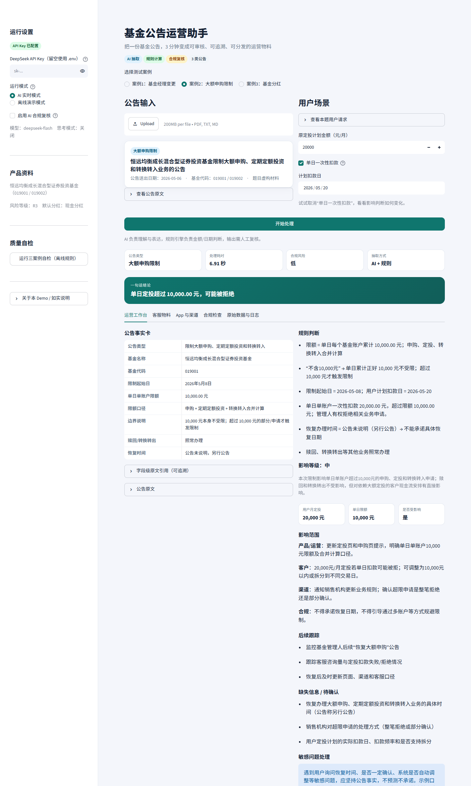
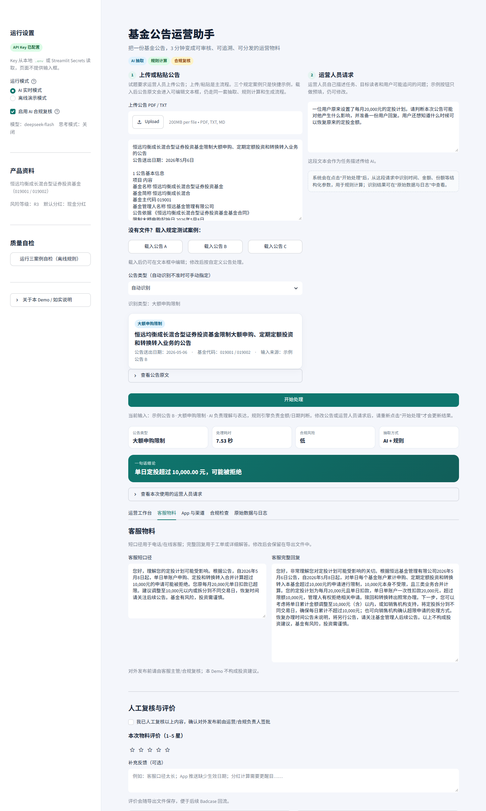
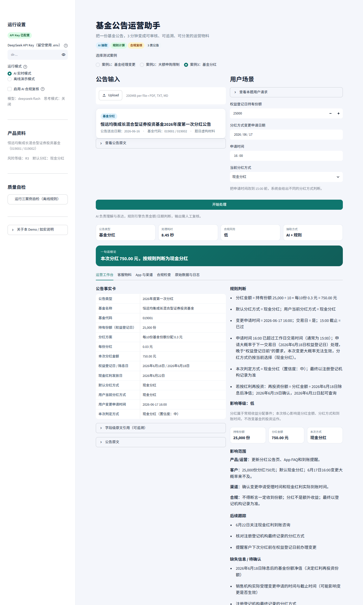
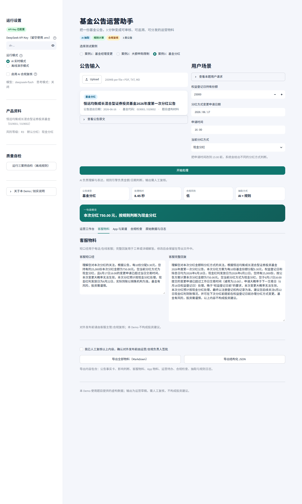

# 基金公告运营助手：设计思路文档

> 岗位：AI 产品经理（2027 届金融科技专场）｜日期：2026 年 10 月 17 日｜全部产品、人物与数据均为考试虚构材料

## 0. 一句话定位

**基金公告运营助手：上传一份公告，自动完成结构化理解、影响判断、多角色材料生成与合规复核；运营人员只需审核和发布。**

当前 Demo 聚焦“单份公告”的完整核心流程；批量解析、场景问答置信度分流等能力列入路线图。

## 1. 问题分析

### 1.1 业务背景

公募基金公司会持续发布基金经理变更、申购限制、基金分红等不同类型公告。公告发布后，运营人员需要：阅读公告 → 理解内容 → 根据用户可能关心的问题准备运营与客服材料。不同公告涉及的业务、用户和后续处理方式差异很大，且公告往往集中发布。

### 1.2 现状与痛点

| 层面 | 具体表现 | 业务影响 |
|---|---|---|
| 效率 | 公告扎堆（月末/季末）时逐份人工阅读整理，每份 30–60 分钟 | 处理积压，响应滞后 |
| 质量 | 靠人读易漏关键字段：生效日期、限额口径、权益登记日等，抄错即事故 | 口径不统一，跨团队不一致 |
| 合规 | 公告通常只披露事实，不披露深层原因；模型很容易“补全”原因或做涨跌判断 | 监管处罚/投诉/声誉风险 |
| 责任 | 缺少留痕和复盘：难以追溯“这句话来自哪条公告”“数字怎么算的” | 风险敞口，责任归属不清 |

### 1.3 机会判断

1. **公告结构化程度高**：基金公告按监管要求以固定模板披露（基金基本信息、生效日期、关键业务参数等），适合 AI 抽取与生成。
2. **用户问题可枚举**：每类公告的高频用户问题高度相似（FAQ 模式成熟），AI 生成 + 人工复核可规模化。
3. **合规可规则化**：监管红线可沉淀为话术规则库，由系统自动校验——这是金融场景独有的“AI 可落地”机会。

### 1.4 成功指标

| 指标 | 目标 | 当前 Demo |
|---|---|---|
| 单份公告处理时间 | 30–60 分钟 → 3 分钟 | AI 模式约 6–8 秒生成草稿 |
| 关键字段准确率 | ≥ 95% | 三个规定案例关键字段全部正确（自检 14/14） |
| 红线拦截率 | 100% | 三个案例 0 项违规；高风险自动回退 |
| FAQ 一次采纳率 | ≥ 80% | 尚未做真实用户测试（设计目标） |
| Badcase 回流率 | 持续监控 | 未实现（路线图） |

## 2. 产品方案

### 2.1 产品定位

**不是“公告摘要工具”，而是“公告运营工作台”。**

面向基金公司运营/客服人员的公告智能处理工具，把一份公告自动处理为一套可直接使用的运营材料（客服 FAQ、App 文案、内部执行清单）——**上传 → AI 解析 → 一键产出**。

### 2.2 核心流程

| 步骤 | 做什么 | 由谁完成 |
|---|---|---|
| STEP 1 公告输入 | 上传 PDF / 粘贴文本 / 载入示例公告 A/B/C；运营人员填写自由文本请求 | 人 |
| STEP 2 类型识别 + 结构化抽取 | 公告类型识别（经理变更/限购/分红/其他）→ 按 JSON Schema 抽取关键字段，附原文引用，校验缺失字段 | AI |
| STEP 3 规则校验与计算 | 金额/日期/份额/15:00 交易截止/边界值等规则判定与计算（如分红金额、限额判定） | AI + 规则引擎 |
| STEP 4 运营要点提炼 | 事件速递 → 生效时间 → 影响范围 → 对用户/运营/合规的关键提示 | AI |
| STEP 5 多角色材料生成 | 客服 FAQ + App 文案 + 内部执行清单（按角色产出，口径统一） | AI |
| STEP 6 合规扫描 | 禁语红线/关键事实一致性/数字核对/风险提示自动扫描 | 合规引擎 + AI 复核 |
| STEP 7 人工复核 + 导出 + 留痕 | 人工审核确认 → 导出交付 → 操作留痕（可审计） | 人 |
| STEP 8 场景问答（规划中） | 用户画像匹配 → 置信度判定：高置信 AI 直接答/低置信转人工/红线拦截 | AI 建议 + 人确认 |

STEP 8 的完整置信度分流未在本 Demo 实现；当前由“用户 FAQ + 敏感问题处理”覆盖简化版。

流程遵循“输入 → AI 能力 → 输出”的表达规范，每一步明确标注由 AI 完成、由人完成、还是人机协作。

### 2.3 功能模块

**第一层 · 公告理解引擎（解决“读公告太慢”）**

- 结构化抽取：谁、什么事、何时生效、金额/额度是多少
- 公告分类：基金经理变更/限购/分红/其他公告；其他类型可走通用抽取
- 关键条款高亮与原文引用，不需要运营自己翻
- 批量上传 → 批量总结（规划中，当前 Demo 为单份处理）

**第二层 · 影响分析（解决“读了公告不知道怎么办”）**

- 这份公告会影响哪类用户
- 用户可能会问什么问题（FAQ 预判）
- 触发后续动作：更新 FAQ、发推送、通知渠道方
- 基金经理变更：影响等级、管理稳定性、影响范围、后续跟踪
- 限购：单日单账户限额、合并计算口径、恢复时间未公告
- 分红：分红金额、权益登记日、15:00 截止、默认分红方式

**第三层 · 材料生成（输出层）**

- 客服应答口径（短口径/完整回复）
- App 推送文案
- 内部同步通知
- FAQ 更新条目
- 运营待办清单

**横切能力（贯穿三层）**

- 人机协同审核流：AI 产出全部为“待审核”，按风险分级流转（低/中/高），全链路留痕
- 场景问答：输入用户场景，意图识别 → 风险与置信度判定 → 分流生成合规回复（规划中；当前以 FAQ + 敏感问题处理覆盖）

### 2.4 输入与输出

**输入**

- 公告原文：上传 PDF / TXT / Markdown，或直接粘贴文本；三个规定案例可快捷载入
- 运营人员请求：自由文本，作为任务描述传给 AI；示例按钮只做预填，仍可编辑
- 产品基本资料：基金名称、代码、A/C 份额、风险等级、默认分红方式等
- 结构化参数：系统在点击“开始处理”后从请求中识别时间、金额、份额等，用于规则计算；不要求运营人员单独填写，识别结果可在“原始数据与日志”查看

**输出（10 项）**

1. 公告事实卡（字段 + 原文引用）
2. 影响判断（规则计算 + 影响等级 + 影响范围）
3. 客服短口径/完整回复
4. App 推送标题与正文
5. 用户 FAQ
6. 运营待办清单
7. 合规风险等级、违规项与改写建议
8. 缺失信息/待确认事项
9. 后续跟踪清单
10. 处理日志（抽取方式、模型用量、耗时、结构化参数）

### 2.5 人机协同设计（人工与 AI 的边界）

这是本产品区别于“普通 AI 工具”的核心机制：**分级自动化 + 人在回路 + 全留痕**。

| 输出物 | 风险等级 | AI 的权限 | 人的介入 |
|---|---|---|---|
| 公告速递、内部执行清单 | 低 | 自动生成 | 轻量浏览确认 |
| 客服 FAQ、App 文案 | 中 | 生成 + 合规自检打标 | 必须人工审核后才可发布 |
| 收益承诺/离任归因/恢复时间等 | 高 | 只给建议口径 | 强制人工决策，AI 不直接答复 |

**三条铁律**：

1. AI 只“备料”不“发布”——对外发布动作永远由人完成；
2. 置信度打标——AI 对自己的输出标“高置信/需人工复核”；
3. 全链路留痕——AI 生成什么、人改哪里、谁审核，全部可追溯（金融合规审计标配）。

### 2.6 复核与审计机制

- 所有输出标注“运营草稿”，必须人工复核
- 页面提供“我已人工复核”勾选，导出文件记录复核状态
- 合规风险为“高”时自动回退安全模板，并在页面与日志说明
- 导出 Markdown/JSON，保留事实卡、规则过程、合规检查、模型用量，便于复盘

## 3. AI 应用方式

### 3.1 AI 分工与边界

**边界总览**：

- **AI 放开做**：公告分类/字段抽取/运营速览/内部清单
- **半自动**：对外客服话术与 App 文案须人工审核
- **禁区**：离任归因/涨跌预测/收益承诺/恢复时间承诺，AI 只给建议口径，强制人工决策

**核心原则**：**LLM 负责理解和表达，规则负责计算和判断，人负责签字和发送。**

| 环节 | 谁来做 | 原因 |
|---|---|---|
| 公告分类 | 关键词 + LLM | 公告关键词明显，LLM 兜底 |
| 字段抽取 | LLM + JSON Schema | 公告为非结构化文本，需要语义理解 |
| 金额/日期/份额计算 | 规则引擎 | 大模型算术与日期边界不可靠，必须可审计 |
| 文案生成 | LLM | 需针对客服/App/渠道生成不同语气与长度 |
| 敏感问题识别 | LLM + 规则 | 识别“业绩不好”“一定跌”等意图 |
| 合规检查 | 规则 + AI 复核 | 规则保证红线，AI 补充语义判断 |
| 最终发布 | 人 | 运营/合规签批，AI 不直接对外 |

### 3.2 模型选择与思考模式

- 模型：**DeepSeek V4.1 Flash**（API model 名：`deepseek-flash`）。
- 该模型支持思考模式。开启时单份公告会增加约 20–50 秒推理延迟，并消耗更多 completion tokens。
- 本 Demo 对“结构化抽取 + 运营文案”默认关闭思考模式（`DEEPSEEK_THINKING=disabled`），实测单份公告约 6–8 秒；复杂公告或深度分析可通过 `.env` 改为 `enabled`。
- 关闭的是显式思考链，不是换模型；金额、日期、份额等关键计算仍由规则引擎保证。

### 3.3 场景问答：置信度分流（规划中）

借鉴 AI 客服的最佳实践（意图识别 → 置信度判断 → 高低分流 → Badcase 回流），结合金融场景的“风险等级”维度，规划如下分流：

```text
用户问题
   │
   ▼
意图识别（离任原因/涨跌/恢复时间/分红方式/费用/其他）
   │
   ▼
风险判定（高/中/低）
   │
   ├── 高风险：命中“归因/预测/承诺”红线 → 固定合规口径 + 转人工
   ├── 中风险：高置信 → AI 草稿 + 人工确认；低置信 → 转人工
   └── 低风险：高置信 → AI 直接答；低置信 → 转人工
```

本 Demo 尚未实现完整的置信度分流；当前以“敏感问题处理 + FAQ + 合规检查”覆盖核心场景，完整分流列入路线图。

## 4. 合规话术设计与护栏

### 4.1 红线规则

| 红线规则 | 系统处理策略 |
|---|---|
| 禁止对离任原因做业绩归因 | 只采用公告口径“因工作安排离任”，不推测、不暗示与产品表现关联；公告未披露转任安排时，明确说“公告未说明”，不编造具体岗位/去向 |
| 禁止预测涨跌/承诺收益 | 话术内置“基金有风险，投资需谨慎”“历史业绩不代表未来表现”等风险提示 |
| 禁止承诺恢复时间 | 统一口径“以公司后续公告为准”，建议关注官方公告；恢复提醒订阅为规划能力，不承诺具体日期 |
| 分红方式变更有效性 | 按“权益登记日前最后一次有效选择”判定，并结合工作日 15:00 交易截止：6 月 17 日 16:00 提交的变更顺延至 6 月 18 日（权益登记日当天）记录，不满足“权益登记日前”要求 → 大概率不生效，明确告知用户仍按现金分红 |
| 不诱导用户转移 | 解释限购原因时只使用公告口径“保护基金份额持有人利益”，不延伸推测规模/收益影响，不引导用户转投其他产品 |

### 4.2 生成后校验与双层护栏

文案生成后做规则校验：

- 关键数字是否出现（750 元/10,000 元）
- 是否含禁语/保证性表述
- 是否含风险提示
- 是否缺失关键事实（如“张晨继续管理”）
- 数字是否与规则计算结果一致

不通过自动回退安全模板并说明。**规则层 + AI 复核层默认开启**（可在侧边栏关闭），合并取更高风险等级；高风险文案不会直接对外。

## 5. 三个规定测试案例与实测结果

> 以下结果为 Demo 实际运行输出。AI 实时模式措辞可能因模型生成略有差异；离线模式使用固定安全模板。截图见 `docs/screenshots/`。

### 5.1 案例1：基金经理变更

**输入**：公告 A；运营人员请求：“请帮我整理这份公告，准备一份可以提供给客服和 App 运营人员使用的材料。用户可能会问：基金经理离任是不是因为产品表现不好？基金后面是不是一定会跌？”

**事实卡（实际输出）**

| 字段 | 内容 |
|---|---|
| 公告类型 | 基金经理变更（解聘基金经理） |
| 基金名称 | 恒远均衡成长混合型证券投资基金 |
| 基金代码 | 019001 |
| 离任基金经理 | 李明 |
| 离任原因 | 工作安排 |
| 离任日期/生效日 | 2026年4月15日 |
| 继续管理的基金经理 | 张晨 |
| 协会变更手续 | 已按规定办理 |
| 转任本公司其他岗位 | 公告未说明（公告未披露） |
| 公告边界 | 未提及基金终止、清盘、基金合同变更或投资策略调整 |

**关键判断**

- 李明因“工作安排”离任本基金基金经理，自 2026-04-15 生效；
- 本基金仍由张晨管理，不是无人管理；
- 公告未披露离任与业绩的关系，不能推断“因为业绩不好”；
- 无法预测基金未来涨跌，不能回答“一定跌/不会跌”；
- “离任本基金基金经理”不等于“从公司离职”。

**客服短口径（实际输出）**

> 您好，理解您对基金经理变更的关注。根据公告，李明因工作安排于2026年4月15日离任本基金基金经理，本基金仍由张晨继续管理，协会变更手续已办理。公告未披露离任与业绩相关，也无法预测未来涨跌。基金有风险，投资需谨慎，以上不构成投资建议。

**合规检查**：风险等级低；4 项通过，0 项违规。









### 5.2 案例2：大额申购限制

**输入**：公告 B；运营人员请求：“一位用户原来设置了每月20,000元的定投计划。请判断本次公告可能对他产生什么影响，并准备一份用户回复。用户还想知道什么时候可以恢复原来的定投金额。”

**事实卡（实际输出）**

| 字段 | 内容 |
|---|---|
| 公告类型 | 限制大额申购、定期定额投资和转换转入 |
| 限制起始日 | 2026年5月8日 |
| 单日单账户限额 | 10,000.00 元 |
| 限额口径 | 申购 + 定期定额投资 + 转换转入合并计算 |
| 边界说明 | 10,000 元本身不受限；超过 10,000 元的部分/申请才触发限制 |
| 赎回/转换转出 | 照常办理 |
| 恢复时间 | 公告未说明，另行公告 |

**关键判断**

- 用户每月 20,000 元，如果是一次性单日扣款，单日单账户累计超过 10,000 元，管理人有权拒绝；
- 如果计划分散到多日、每日累计不超过 10,000 元，则不受影响；
- 10,000 元本身可以，10,000.01 元触发限制；
- 赎回、转换转出不受影响；
- 恢复时间公告称“另行公告”，不能承诺具体日期。

**客服短口径（实际输出）**

> 理解您对定投计划的关心。根据公告，自2026年5月8日起，单日单账户累计申购、定投和转换转入超过10,000元的申请可能被拒绝，您的20,000元定投若单日扣款将超限。恢复时间公告未说明，需另行公告。建议您将单日金额调整至10,000元（含）以内，或咨询销售机构超限处理方式。基金有风险，投资需谨慎。

**合规检查**：风险等级低；包含 10,000 元限额、另行公告、赎回/转换转出不受影响等关键事实。





### 5.3 案例3：基金分红

**输入**：公告 C；运营人员请求：“一位用户在权益登记日持有25,000份基金份额。他想知道本次分红金额，以及自己会收到现金还是基金份额。用户还表示，他在6月17日16:00申请将分红方式改为红利再投资。”

**计算**

- 每 10 份分红 0.30 元 → 每份 0.03 元；
- 25,000 ÷ 10 × 0.30 = **750.00 元**。

**事实卡（实际输出）**

| 字段 | 内容 |
|---|---|
| 公告类型 | 2026年度第一次分红 |
| 持有份额（权益登记日） | 25,000 份 |
| 分红方案 | 每10份基金份额分配 0.3 元 |
| 每份分红 | 0.03 元 |
| 本次分红金额 | 750.00 元 |
| 权益登记日/除息日 | 2026年6月18日/2026年6月18日 |
| 现金红利发放日 | 2026年6月22日 |
| 默认分红方式 | 现金分红 |
| 用户当前分红方式 | 现金分红 |
| 用户变更申请时间 | 2026-06-17 16:00 |
| 本次判定方式 | 现金分红（置信度：中） |

**关键判断**

- 6 月 17 日 16:00 已超过工作日交易时间（通常 15:00），申请大概率于下一交易日（6 月 18 日权益登记日）处理，晚于“权益登记日前”的要求；
- 因此本次大概率仍按现金分红 750 元处理；
- 最终分红方式以注册登记机构记录为准，建议用户在 App 确认；
- 如果按红利再投资：份额 = 750 元 ÷ 6 月 18 日除息后净值，6 月 19 日确认，6 月 22 日起可查询；
- 分红不是额外收益，除息后基金份额净值会相应下降。

**客服短口径（实际输出）**

> 理解您对本次分红到账方式的关注。根据公告，每10份分红0.30元，您持有的25,000份对应分红750.00元。您6月17日16:00提交的变更申请已超过通常15:00交易时间，本次大概率将按现金分红处理，最终以登记机构记录为准。现金红利发放日为6月22日，实际到账以销售机构为准。基金有风险，投资需谨慎，以上不构成投资建议。

**合规检查**：风险等级低；包含 750 元、现金分红、6 月 22 日、登记机构等关键事实；未出现 7,500 元错误。





## 6. 效果评估与数据闭环

### 6.1 指标

| 指标 | 定义/口径 | 目标值 |
|---|---|---|
| 字段抽取准确率 | 公告关键字段（代码/日期/金额/方案）抽取与人工标注一致率 | ≥ 95% |
| FAQ 一次采纳率 | 运营人员未经修改直接采纳的 FAQ 占比 | ≥ 80% |
| 红线拦截率 | 高危话术（归因/预测/承诺）被规则库自动拦截的覆盖率 | 100%（零遗漏） |
| Badcase 回流率 | 人工打回样本进入优化池并触发迭代的比例 | 持续监控 |

### 6.2 当前实测

- 三个规定案例：全部跑通，离线自检 **14/14** 通过
- 边界测试：**11/11** 通过（10,000/10,000.01、16:00/14:00、分散定投、当前已是红利再投资等）
- 合规检查：三个案例 **0 项违规**
- AI 实时模式：单份公告约 **6–8 秒**（DeepSeek V4.1 Flash，默认关闭思考模式）
- 离线模式：规则抽取 + 安全模板，可复现，不调用大模型

### 6.3 Badcase 回流（规划）

把“审核”变成“标注”：运营人员每次采纳（点赞）或打回（点踩）都是训练信号，回流后用于更新话术库、规则库与抽取模板，实现模型/规则的持续迭代。本 Demo 尚未实现该闭环。

金融场景用户/投资者对 AI 首次出错极易流失信任，因此高风险问题强制人工、低置信转人工，本质是把“AI 不完美”用产品设计兜住，而非让用户承担错误成本。

## 7. 与 FinClaw 参考 Skill 的关系

设计过程中参考了 FinClaw 的基金公告解读、基金经理变更解读、分红解读、市场快讯生成、敏感措辞识别等 Skill。

### 7.1 借鉴的部分

1. **证据链优先**：结论对应证据，不能只给标签。对应本 Demo 的 `source_quotes` 和字段级原文引用。
2. **区分事实、判断、待核验事项**：对应“公告事实卡/规则计算/缺失信息”三块，以及“公告未说明”的兜底。
3. **基金经理变更的事件化分析**：参考其“事件类型、影响等级、管理稳定性、风格延续性、团队支持、跟踪建议”框架，本 Demo 增加了“影响等级、影响范围、后续跟踪”。
4. **对产品/客户/渠道的分角色影响**：对应“影响范围”和“多角色物料”。
5. **敏感措辞识别的风险等级 + 改写建议**：对应合规检查的风险等级、违规项、修改建议、自动回退。
6. **人工复核边界**：参考其“需人工复核/不替代法务或正式公告口径”，本 Demo 强制人工复核勾选，并在导出文件记录。
7. **结构化输出习惯**：参考 `input_summary / key_findings / data_quality / limitations`，本 Demo 保留抽取、规则、合规、日志和缺失信息。

### 7.2 刻意不同的部分

1. **场景不同**：部分 Skill 偏投研分析，会输出“偏正面/中性/偏负面”等判断；本题是运营/客服场景，我们刻意不做买卖建议，不输出“是否值得持有”的结论。
2. **计算方式不同**：参考 Skill 多为 Prompt/模板驱动；本 Demo 把金额、日期、份额、15:00 截止等做成显式规则引擎，保证可审计、可复现。
3. **交付形态不同**：本 Demo 是可交互的工作台，不是一份 Skill 说明；评审可以改输入、看规则变化、导出物料。
4. **合规策略不同**：生成后做规则校验，高风险自动回退安全模板，而不是只依赖 Prompt 约束。
5. **范围不同**：参考 Skill 覆盖更多公告类型；本 Demo 完整规则覆盖三类高频公告，其他类型走通用抽取/人工复核，并保持可扩展。

## 8. 技术实现

### 8.1 架构

> 注意：本 Demo 不是上传 Word 中描述的“单页自包含 HTML + 纯规则模板”，而是 Streamlit + DeepSeek API 的实际实现。

```text
公告 PDF/TXT/粘贴文本 + 运营人员请求
        │
        ▼
Streamlit 工作台（app.py）
        │
        ├── 类型识别（关键词 + 规则）
        ├── AI 抽取（DeepSeek V4.1 Flash + JSON Schema）
        ├── 规则引擎（金额/日期/份额/15:00/边界）
        ├── 多角色材料生成（AI + 安全模板）
        ├── 合规检查（规则 + AI 复核，默认开启）
        ├── 人工复核 + Markdown/JSON 导出
        └── 原始数据与日志（含从请求解析的结构化参数）
```

### 8.2 数据与规则

- 产品基础资料：基金名称、代码、A/C 份额、风险等级、默认分红方式
- 公告 A/B/C 全文与结构化字段：`data/announcements.json`、`data/cases.json`
- 规则引擎：`core/rules.py`，使用 Decimal 计算，避免浮点误差
- 合规引擎：`core/compliance.py`，禁语/关键事实/数字一致性/风险提示
- 抽取与生成：`core/extractor.py`、`core/generation.py`、`core/prompts.py`
- 端到端流程：`core/pipeline.py`

### 8.3 部署

- 本地：`streamlit run app.py`
- 稳定公网：**Streamlit Community Cloud**
  - https://fund-announcement-assistant.streamlit.app/
- 代码仓库：https://github.com/superchild2022/fund-announcement-assistant
- 备用：本地 Streamlit + Cloudflare Quick Tunnel（`start_public.ps1`）

### 8.4 安全与密钥

- API Key 不提供页面输入框；本地从 `.env` 读取，Streamlit Cloud 从 Secrets 读取
- `.env` 已加入 `.gitignore`，不进入提交包/仓库
- 导出的 Markdown/JSON 不包含 Key
- 输出为运营草稿，必须人工复核，不构成投资建议

## 9. 局限与迭代路线

### 9.1 当前局限

1. **公告类型覆盖**：完整规则覆盖基金经理变更、限购、分红三类高频公告；其他类型可走“其他公告（通用抽取）”并转人工复核，清盘、持有人大会、合同修订、费率调整等专用规则仍待扩展。架构按类型路由，新增类型只需补充抽取 Schema、规则和话术模板。
2. **批量处理未实现**：当前为单份公告流程；批量上传/汇总列入路线图。
3. **场景问答置信度分流未实现**：当前以 FAQ + 敏感问题处理覆盖；完整分流列入路线图。
4. **数据源未接入**：没有真实公告订阅、注册登记机构、销售机构接口；“恢复公告监控”未实现。
5. **解析能力有限**：PDF 表格、扫描件 OCR、跨页公告可能抽取不完整。
6. **AI 波动**：同一公告不同次生成措辞可能不同；已用规则校验和安全回退降低风险，但仍需人工复核。
7. **未做真实用户评估**：人工修改率、客服采纳率、一次解决率尚未量化。
8. **公网链接**：稳定链接部署在 Streamlit Community Cloud；本地 Quick Tunnel 作为备用，依赖本机进程。

### 9.2 迭代路线

**P0（当前 Demo）**

- 三类高频公告端到端
- 事实卡 + 影响判断 + 多角色物料
- 规则引擎 + 合规检查 + 人工复核 + 导出
- 其他公告通用抽取 + 人工复核

**P1（可用性增强）**

- 批量上传、公告去重、优先级排序
- 增加清盘、持有人大会、合同修订、费率调整等公告类型
- 接入公告源，自动监控“恢复大额申购”等后续公告
- 渠道模板配置化，支持不同销售机构口径

**P2（运营闭环）**

- 影响用户圈选：按持有份额、定投计划、分红方式筛选受影响客户
- 生成渠道通知任务和客服工单
- 接入 CRM/企微/App 内容系统
- 反馈闭环：人工修改记录回流，优化 Prompt 和模板
- 场景问答置信度分流 + Badcase 回流

**P3（质量与规模化）**

- 公告评测集与自动评分（字段准确率、规则正确率、合规违规率）
- Prompt/规则版本管理与 A/B 测试
- 多语言、多市场扩展
- 合规规则库与监管条款映射

## 10. 运行与复现

### 10.1 本地运行

```powershell
pip install -r requirements.txt
streamlit run app.py
```

浏览器打开 `http://localhost:8501`。

### 10.2 公网体验

**稳定链接（Streamlit Community Cloud）：**

https://fund-announcement-assistant.streamlit.app/

**代码仓库：**

https://github.com/superchild2022/fund-announcement-assistant

本地/临时备用：

```powershell
.\start_public.ps1
```

### 10.3 测试

```powershell
python tests/test_cases.py
python tests/test_cases.py --llm
python tests/test_boundaries.py
```

测试输出留档：`docs/test_results.txt`（三案例自检 + 边界测试）。

### 10.4 截图

- `docs/screenshots/01_home.png`
- `docs/screenshots/02_case1_workbench.png`
- `docs/screenshots/03_case1_cs.png`
- `docs/screenshots/03b_case1_app.png`
- `docs/screenshots/04_case1_compliance.png`
- `docs/screenshots/04b_case1_logs.png`
- `docs/screenshots/05_case2_workbench.png`
- `docs/screenshots/05b_case2_cs.png`
- `docs/screenshots/06_case3_workbench.png`
- `docs/screenshots/07_case3_cs.png`

## 11. 如实说明

1. 本题三类公告为题目提供的虚构材料，Demo 未使用真实基金/客户数据。
2. Demo 的 AI 能力使用 **DeepSeek V4.1 Flash API** 做抽取、文案生成和合规复核；金额、日期、份额等关键计算由规则引擎完成。离线模式使用规则抽取 + 安全模板，不调用大模型。
3. 三个规定案例的规则判断可离线复现；截图和测试输出已留档。
4. 未接入真实注册登记机构、销售机构、公告源系统；“恢复时间”“除息后净值”等公告未披露信息只提示缺失，不编造。
5. AI 实时生成存在措辞波动；系统会做规则校验，高风险时自动回退安全模板，但仍需人工复核。
6. 当前完整规则覆盖三类高频公告；其他类型可走“其他公告（通用抽取）”并转人工复核，新增专用类型可继续扩展。
7. 批量处理、场景问答置信度分流、Badcase 回流、恢复公告监控未实现，已列入路线图。
8. 稳定链接部署在 Streamlit Community Cloud；本地 Quick Tunnel 作为备用，依赖本机进程。
9. 输出为运营草稿，不构成投资建议，不替代合规/法务的正式审核。

## 附录：目录结构

```text
app.py                          Streamlit 工作台
core/
  config.py                     配置与数据加载
  llm.py                        DeepSeek API 封装
  prompts.py                    抽取/生成/合规 Prompt
  extractor.py                  分类、AI抽取、规则抽取、冲突合并
  rules.py                      三类公告规则引擎 + 通用抽取
  generation.py                 多角色物料生成与安全回退
  compliance.py                 合规检查
  pipeline.py                   端到端流程与自检
data/
  fund_profile.json             产品基本资料
  announcements.json            公告 A/B/C 原文
  cases.json                    三个测试案例与期望结果
docs/
  design.md                     本文档（Markdown）
  design.html                   本文档（HTML，含截图和左侧目录导航）
  test_results.txt              三案例自检 + 边界测试输出
  screenshots/                  实际运行截图
tests/
  test_cases.py                 三个规定案例自检
  test_boundaries.py            边界测试
  ui_flow.py                    浏览器端到端演示与截图
start_public.ps1                一键本地临时公网体验
requirements.txt
```
